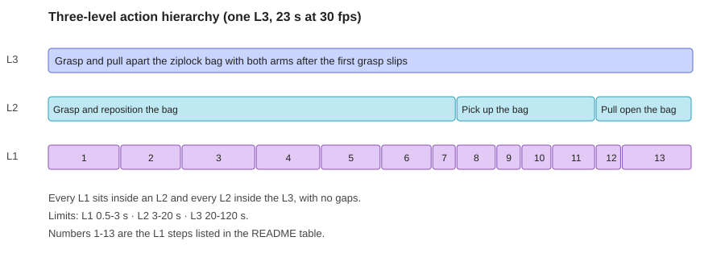

# Robot Video Annotation: hierarchical action labelling

Frame-accurate labelling of bimanual robot-manipulation video (30 fps), using synchronized overhead and left/right wrist-camera views.

> This repo contains my method and my own labels only. It does not include any videos, screenshots or confidential platform guidelines.

## Experience at a glance

| | |
|---|---|
| Footage | Two ~2-minute robot videos (≈3,600 frames at 30 fps), plus shorter practice clips |
| Output | 200+ time-aligned labels across three levels |
| Task types | Yarn lifting and unwinding, a ziplock bag grasp-and-open with a slip, passing a wooden stick between arms, handing a string to the right arm |
| Checks | Frame-accurate boundaries, which arm acts, gripper open/close state, object contact, failure labelling |
| Validator | Cleared all errors; triaged the remaining warnings against the guidelines |

## The three levels

| Level | Meaning | Allowed length |
|---|---|---|
| L1 | One atomic motor action (e.g. close a gripper) | 0.5 to 3 s |
| L2 | A sub-task with a clear start and end state | 3 to 20 s |
| L3 | The overall goal, including any major failure | 20 to 120 s |

Rules I worked to: no gaps or overlaps, each span fully inside its parent, command-form labels starting with a base-form verb, the acting arm and gripper named, consistent object names, US spelling.

### Example: the L1 steps in the diagram

| # | L1 label | Frames |
|---|---|---|
| 1 | Move the left arm toward the ziplock bag on the table | 2905-2983 |
| 2 | Lower the left gripper onto the edge of the ziplock bag | 2983-3049 |
| 3 | Close the left gripper on the edge of the ziplock bag | 3049-3129 |
| 4 | Reposition the left gripper on the ziplock bag | 3129-3199 |
| 5 | Drop the ziplock bag as it slips off the left gripper | 3199-3264 |
| 6 | Lower the left gripper onto the top flap of the ziplock bag | 3264-3319 |
| 7 | Position the left gripper on the top flap of the ziplock bag | 3319-3345 |
| 8 | Move the right arm toward the ziplock bag | 3345-3388 |
| 9 | Lower the right gripper onto the ziplock bag | 3388-3415 |
| 10 | Close the right gripper on the pink zipper strip of the ziplock bag | 3415-3448 |
| 11 | Lift the ziplock bag off the table with the right arm | 3448-3495 |
| 12 | Close the left gripper on the opposite side of the ziplock bag | 3495-3523 |
| 13 | Pull the ziplock bag apart with both arms | 3523-3599 |

Failures get their own label: step 5 records the slip instead of hiding it inside another action, and the L3 names the failure.

## My workflow

1. Watch the overhead camera once to find the L3 goals and major failures.
2. Set L2 boundaries where the intent becomes clear and the sub-task ends or fails.
3. Set L1 boundaries on the wrist cameras, where a gripper actually opens, closes or makes contact.
4. Convert durations to frames (L1 is 15 to 90 frames at 30 fps).
5. Run the validator, then classify every flag as a real error or noise.

## Self-audit: errors I found by re-watching the footage

The validator cannot see the video, so I re-checked my labels against the wrist cameras:

| Problem | What the footage showed | Fix |
|---|---|---|
| Lift labelled with the wrong arm | The right gripper, not the left, held the bag | Relabelled "with the right arm" |
| Two "open" labels in a row on one gripper | The gripper opened once; the second label was really an arm movement | Replaced it with a movement label |
| A gripper release with no label | The right gripper opened between two segments | Added the open to the label |
| Stale wording ("strand held by the right gripper") | The right gripper had already released | Reworded to what was visible |
| A close labelled where the gripper stayed open | The left gripper never actually closed on the flap | Relabelled as positioning |
| A label describing the opposite of the motion ("lift" for a descent) | The arm was moving down toward the object | Corrected to "lower" |
| Several near-identical small steps | They described one continuous motion | Merged within the length limits |

## Validator triage

My rule: **if the footage contradicts a flag, trust the footage; if my label contradicts the footage, fix the label.**

- **Real errors:** a gripper labelled closed twice with no release, a label naming the wrong arm, or an unlabeled open or close.
- **Noise:** state-tracking flags that cascade from one earlier flag, or that read the word "open" in "with the open gripper" as an open event.
- **Over-segmentation warnings:** merging would push L1 spans past the 3 s limit, so I kept the finer split.

## What I'd do differently

- Mark gripper open/close frames on the first pass instead of during review.
- Write failure labels (missed grasps, slips, drops) while watching, not afterwards.
- Check each label's arm against the wrist camera before moving on.
